<!-- ╔══════════════════════════════════════════════════════════════════╗
     ║  SUHAS KANWAR — github.com/SuhasKanwar                           ║
     ║  Custom SVGs live in /assets and are animated with pure CSS.     ║
     ╚══════════════════════════════════════════════════════════════════╝ -->

<div align="center">



<a href="https://github.com/SuhasKanwar">
  
</a>

<br/>

<a href="https://www.linkedin.com/in/suhas-kanwar-4a3a09291/"></a>
<a href="mailto:suhas.kanwar@gmail.com"></a>
<a href="https://leetcode.com/u/Suhas_Kanwar/"></a>
<a href="https://codeforces.com/profile/suhas.kanwar"></a>


</div>


<!-- ─────────────────────────────  WHOAMI  ───────────────────────────── -->
<div align="center">
  
</div>

<details>
<summary><b>📜 &nbsp;Read the plain-text version</b></summary>
<br/>

I'm a **Software Engineer & AI Developer** who loves building **intelligent, scalable systems** — from large-scale backends and autonomous AI agents to computer vision, RAG pipelines and developer infrastructure. My interests span **full-stack engineering, multimodal AI, distributed systems, cloud infrastructure and blockchain**.

Currently pursuing a **B.Tech in Computer Science Engineering** at **BML Munjal University (CGPA 9.08)**. I've shipped production-ready AI systems, cloud-native apps and decentralised finance platforms across startups and research projects.

</details>


<!-- ─────────────────────────────  EXPERIENCE  ───────────────────────────── -->
<h2 align="center">⚡ Career.log</h2>

<div align="center">
  
</div>


<!-- ─────────────────────────────  STACK  ───────────────────────────── -->
<h2 align="center">🛠️ The Arsenal</h2>

<div align="center">

<table>
  <tr>
    <td align="center" width="160"><code>01</code><br/><b>Languages</b></td>
    <td align="center"></td>
  </tr>
  <tr>
    <td align="center"><code>02</code><br/><b>Frameworks</b></td>
    <td align="center">&nbsp;</td>
  </tr>
  <tr>
    <td align="center"><code>03</code><br/><b>Cloud & DevOps</b></td>
    <td align="center"></td>
  </tr>
  <tr>
    <td align="center"><code>04</code><br/><b>Data & Web3</b></td>
    <td align="center">&nbsp;</td>
  </tr>
  <tr>
    <td align="center"><code>05</code><br/><b>AI / ML</b></td>
    <td align="center">
      
      
      
      
      
    </td>
  </tr>
</table>

</div>


<!-- ─────────────────────────────  TROPHIES  ───────────────────────────── -->
<h2 align="center">🏆 Trophy Cabinet</h2>

<div align="center">
  
</div>


<!-- ─────────────────────────────  STATS  ───────────────────────────── -->
<h2 align="center">📡 Telemetry</h2>

<div align="center">


</div>

<!-- ─────────────────────────────  CP  ───────────────────────────── -->
<h2 align="center">⚔️ Arena</h2>

<div align="center">
  <a href="https://leetcode.com/u/Suhas_Kanwar/"></a>
  <a href="https://codeforces.com/profile/suhas.kanwar"></a>
</div>

<!-- ─────────────────────────────  SNAKE  ───────────────────────────── -->
<div align="center">
<br/>
<picture>
  <source media="(prefers-color-scheme: dark)" srcset="https://raw.githubusercontent.com/SuhasKanwar/SuhasKanwar/output/github-contribution-grid-snake-dark.svg"/>
  <source media="(prefers-color-scheme: light)" srcset="https://raw.githubusercontent.com/SuhasKanwar/SuhasKanwar/output/github-contribution-grid-snake.svg"/>
  
</picture>
</div>


<!-- ─────────────────────────────  CONNECT  ───────────────────────────── -->
<div align="center">

```bash
$ ping suhas --reason "internship | collab | hackathon team"
PING suhas.kanwar@gmail.com: 56 data bytes
64 bytes from suhas: icmp_seq=0 ttl=64 time=0.42 ms  ✔ reply guaranteed
```

<a href="mailto:suhas.kanwar@gmail.com"></a>
<a href="https://www.linkedin.com/in/suhas-kanwar-4a3a09291/"></a>
<a href="https://github.com/SuhasKanwar?tab=repositories"></a>

<br/><br/>


</div>
